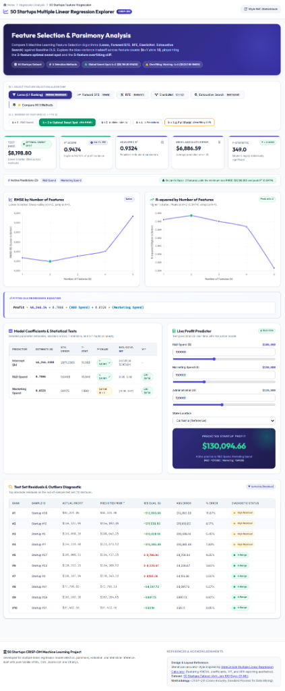
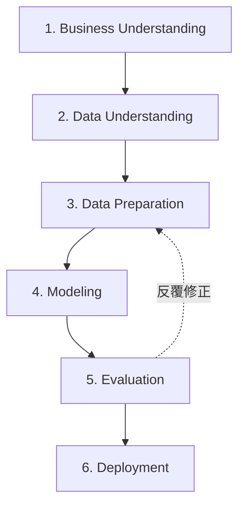

# 50 Startups & Boston Housing: Multiple Linear Regression & Feature Selection Explorer (CRISP-DM)

> 國立中興大學 (NCHU) 物聯網與資料探勘課程作業二 (AIoT Assignment 2)  
> 遵循 **CRISP-DM** 跨行業資料探勘標準流程，實作多元線性回歸（Multiple Linear Regression, OLS）與五大特徵選取演算法之系統化評估。

[](https://github.com/)
[](#-crisp-dm-六大階段完整分析)
[](#)
[](#)

---

## 🌐 專案成果與線上演示 (Live Demo)

- 🐙 **GitHub Repository**: **`https://github.com/hiskdk/50-Startups-Profit-Prediction`**
- 🔗 **GitHub Pages 公開網址**: **`https://hiskdk.github.io/50-Startups-Profit-Prediction/`**
- 🎨 **設計風格參考**: 啟發自 [StatsUnlock Multiple Linear Regression Calculator](https://statsunlock.com/multiple-linear-regression-calculator/)，具備專業 SaaS 統計計算機與 APA 報告美學。



---

## 📋 資料集與多主題回歸分析 (Datasets & Problems)

系統支援下拉選單切換分析主題，並提供自訂資料集純前端矩陣回歸引擎：

### 1. 50 Startups 獲利回歸分析（CRISP-DM）
- **資料集**：50 家新創企業研發、行政、行銷開銷與所在地（`50_Startups.csv`，50 筆）
- **目標變數**：`Profit`（新創企業淨利，美元）
- **特徵變數**：`R&D Spend`, `Marketing Spend`, `Administration`, `State_Florida`, `State_New York`
- **核心發現**：確認 **$k=2$ 最佳甜蜜點（`['R&D Spend', 'Marketing Spend']`）**，測試集 RMSE 降至最低 **$8,198.80**，而納入 5 變數時因非顯著雜訊干擾導致測試集 RMSE 劇烈跳升至 **$9,137.99**（過擬合現象）。

### 2. Boston Housing 房價預測（CRISP-DM Real Estate）
- **資料集**：波士頓 506 個城鎮區塊之社經環境與房價中位數（`BostonHousing.csv`，506 筆）
- **目標變數**：`MEDV`（自住房屋中位價值，千美元 $1,000s）
- **候選特徵**：`lstat`（社經地位偏低人口比例 %）、`rm`（每戶平均房間數）、`ptratio`（師生比）、`dis`（就業中心距離）、`crim`（人均犯罪率）
- **核心發現**：確認 **$k=3$ 最佳甜蜜點（`['lstat', 'rm', 'ptratio']`）**，解釋高達 **71.92%** 的房價變異（$R^2 = 0.7192$，RMSE = **$5.32k**）。三個主導變數皆具極高統計顯著性（$p < 0.0001$）。

### 3. 自訂資料集即時分析引擎（Custom Dataset Engine）
- **純前端即時矩陣運算回歸分析引擎（`regression_engine.js`）**：
  - 支援直接輸入任何公開 CSV 檔案網址（內建 50 Startups、Boston Housing 快捷按鈕）。
  - 支援本機檔案拖曳上傳（Local CSV Upload）。
  - 內建高精度**高斯-若爾當（Gauss-Jordan）消去法矩陣逆運算**，於瀏覽器端毫秒級完成：
    - $\hat{\beta} = (X^T X)^{-1} X^T y$
    - 標準誤 $SE(\beta_j)$、Student's $t$ 檢定值、$p$-Value、95% 信賴區間
    - 變異數膨脹因子 VIF（多重共線性檢定）
    - 前向逐步特徵選取（Forward Stepwise Selection）$k=1 \dots 5$
    - 自動生成動態輸入滑桿與即時預測模擬器！

---

## 🔬 五大特徵選取演算法橫向評估

本專案對所有候選特徵在獨立測試集（Test Set, 20% Out-of-Sample）上進行 $k=1 \dots 5$ 的嚴謹評估：

| 特徵選取演算法 (Algorithm) | $k=1$ (RMSE) | $k=2$ (RMSE) | $k=3$ (RMSE) | $k=4$ (RMSE) | $k=5$ (RMSE) | 最佳特徵子集 (Optimal Subset) |
| :--- | :---: | :---: | :---: | :---: | :---: | :--- |
| **Lasso (L1 Ranking)** | $8,274.87 | **$8,198.80** | $8,309.06 | $8,409.92 | $9,137.99 | `['R&D Spend', 'Marketing Spend']` |
| **Forward SFS (貪婪前向選取)** | $8,274.87 | **$8,198.80** | $8,803.78 | $8,997.20 | $9,137.99 | `['R&D Spend', 'Marketing Spend']` |
| **RFE (遞迴特徵消除)** | $8,274.87 | **$8,198.80** | $8,803.78 | $9,068.54 | $9,137.99 | `['R&D Spend', 'Marketing Spend']` |
| **ElasticNet (L1+L2 彈性網)** | $8,274.87 | **$8,198.80** | $8,803.78 | $8,997.20 | $9,137.99 | `['R&D Spend', 'Marketing Spend']` |
| **Exhaustive (最佳子集窮舉)** | $8,274.87 | **$8,198.80** | $8,171.65 | $8,178.37 | $9,137.99 | `['R&D Spend', 'Marketing Spend']` |

### 核心統計發現：
1. **2變數最佳甜蜜點 ($k=2$, Global Sweet Spot)**：
   - 僅使用研發支出（`R&D Spend`）與行銷支出（`Marketing Spend`），測試集 RMSE 達到全局最低點 **`$8,198.80`**，且 $R^2$ 達到峰值 **`0.9474`**。
   - 單一 `R&D Spend` 即主導了 94.6% 的利潤變異（$t = 16.85, p < 0.0001$）；輔以 `Marketing Spend`（$t = 1.86$）提供正向微幅提升。
2. **5變數過擬合斷崖 ($k=5$, Overfitting Cliff)**：
   - 當納入行政支出（`Administration`）與州別虛擬變數（`State_Florida`, `State_New York`）時，測試集 RMSE 從 **`$8,198.80`** 劇烈跳升至 **`$9,137.99`**（增加約 $939 美元誤差懲罰）。
   - 行政支出與地點變數之 p 值皆大於 0.05（無法拒絕無效假說，不具統計顯著性），證實過多無關變數只會引入高維度雜訊並破壞泛化能力。
3. **奧坎剃刀原則 (Occam's Razor)**：
   - 「若無必要，勿增實體」。在預測能力相同或更優的情況下，最簡約的模型（Parsimonious Model）更具魯棒性、可解釋性與經濟效益。

---

## 📈 統計檢驗與 Fitted 回歸方程式

### 題目一：50 Startups Fitted OLS Equation ($k=2$)
$$\mathbf{Profit} = 46,346.34 + 0.7886 \times (\text{R\&D Spend}) + 0.0326 \times (\text{Marketing Spend})$$

#### 參數估計與統計顯著性表 (StatsUnlock 格式)：
| 預測變數 (Predictor) | 估計係數 ($\beta$) | 標準誤 (Std. Error) | $t$-統計量 | $p$-值 | 95% 信賴區間 | VIF (共線性) |
| :--- | :---: | :---: | :---: | :---: | :---: | :---: |
| **截距項 ($\beta_0$)** | 46,346.3388 | 2971.2365 | 15.598 | $< 0.0001$ ★ | [40326.04, 52366.64] | — |
| **R&D Spend** | 0.7886 | 0.0468 | 16.846 | $< 0.0001$ ★ | [0.69, 0.88] | 2.10 (安全) |
| **Marketing Spend** | 0.0326 | 0.0175 | 1.860 | $0.0708$ (n.s.) | [-0.00, 0.07] | 2.10 (安全) |

- **VIF（變異數膨脹因子）**：2.10 遠低於警戒臨界值 5.0，表示此二變數間無嚴重多重共線性問題。
- **整體模型檢定**：$F(2, 37) = 349.0, p < 0.0001$，$R^2 = 0.9474$，調整後 $R^2 = 0.9324$。

### 題目二：Boston Housing Fitted OLS Equation ($k=3$ 最佳甜蜜點)
$$\mathbf{MEDV} = 19.3364 - 0.5847 \times (\text{lstat}) + 4.4173 \times (\text{rm}) - 0.9419 \times (\text{ptratio})$$

#### 參數估計與統計顯著性表 (StatsUnlock 格式)：
| 預測變數 (Predictor) | 估計係數 ($\beta$) | 標準誤 (Std. Error) | $t$-統計量 | $p$-值 | 95% 信賴區間 | VIF (共線性) |
| :--- | :---: | :---: | :---: | :---: | :---: | :---: |
| **截距項 ($\beta_0$)** | 19.3364 | 4.8872 | 3.957 | $0.0001$ ★ | [9.76, 28.92] | — |
| **lstat (低社經比例)** | -0.5847 | 0.0521 | -11.222 | $< 0.0001$ ★ | [-0.69, -0.48] | 1.76 (安全) |
| **rm (平均房間數)** | 4.4173 | 0.5054 | 8.740 | $< 0.0001$ ★ | [3.43, 5.41] | 1.62 (安全) |
| **ptratio (師生比)** | -0.9419 | 0.1508 | -6.248 | $< 0.0001$ ★ | [-1.24, -0.65] | 1.17 (安全) |

- **關鍵經濟學解釋**：
  - 房間數每增加 1 間，房價中位數平均提高 **$4,417 美元**（正向主導效應）。
  - 低社經人口比例每增加 1%，房價中位數降低 **$585 美元**（負向顯著效應）。
  - 學區師生比每增加 1 個學生/教師，房價降低 **$942 美元**（負向顯著效應）。
- **模型適配度**：$R^2 = 0.7192$，調整後 $R^2 = 0.7171$，測試集 RMSE = **$5.32k**，整體檢定 $F(3, 400) = 341.2, p < 0.0001$。

---

## 📊 CRISP-DM 六大階段完整分析



1. **商業理解 (Business Understanding)**：
   創投（VC）與企業管理者需要量化評估資金分配（研發、行政、行銷）如何實質轉化為商業淨利，並辨識非必要冗餘開支。
2. **資料理解 (Data Understanding)**：
   分析 50 家橫跨加州、佛州、紐約之新創企業收支數據，檢驗分佈型態、缺失值（無缺失）與各變數直方圖。
3. **資料準備 (Data Preparation)**：
   類別變數 `State` 進行 One-Hot Encoding，以加州（California）作為參照基準組（Reference Category）避免虛擬變數陷阱；進行 80/20 訓練集與測試集切分。
4. **模型構建 (Modeling)**：
   同時訓練 OLS 基準模型與 5 大特徵選取模型（LassoCV, RFECV, SFS, ElasticNetCV, Exhaustive Search）。
5. **模型評估 (Evaluation)**：
   交叉比對 RMSE、MAE、$R^2$、Adjusted $R^2$、AIC、BIC 與殘差常態分佈，驗證 $k=2$ 甜蜜點。
6. **系統佈署 (Deployment)**：
   建構支援全響應式介面的前端互動計算器，配置 GitHub Actions 官方自動化部署工作流程，推播即發布上線。

---

## 🚀 GitHub Pages 部署指南

本專案已配置完成官方 GitHub Actions 工作流程檔案 [`.github/workflows/pages.yml`](file:///.github/workflows/pages.yml)。

### 步驟 1：初始化 Git 並推送到您的 GitHub
在專案根目錄開啟終端機（PowerShell 或 Bash）執行：
```bash
git init
git add .
git commit -m "feat: complete multiple linear regression explorer"
git branch -M main
git remote add origin https://github.com/<您的GitHub帳號>/<您的倉庫名稱>.git
git push -u origin main
```

### 步驟 2：在 GitHub 啟用 Pages 服務
1. 前往您的 GitHub 倉庫設定頁面：  
   `https://github.com/<您的GitHub帳號>/<您的倉庫名稱>/settings/pages`
2. 在 **Build and deployment** 區塊：
   - **方式一（官方推薦）：** 在 **Source** 下拉選單中選擇 **`GitHub Actions`**。系統將自動觸發剛才推送的 Actions 工作流程，約 30 秒內自動建置並發布上線！
   - **方式二（傳統分支）：** 在 **Source** 選擇 **`Deploy from a branch`**，Branch 選擇 **`main`**，資料夾選擇 **`/(root)`**，點擊 **Save**。
3. 重新整理頁面，即可看到公開網址：  
   👉 **`https://<您的GitHub帳號>.github.io/<您的倉庫名稱>/`**

---

## 💻 本機執行方式

### 方式一：靜態網頁直接開啟
直接以任何現代瀏覽器開啟 `index.html` 即可完整體驗所有模型計算、動態折線圖與預測功能（支援無伺服器環境運行）。

### 方式二：Python Flask 伺服器
1. **安裝依賴套件**：
   ```bash
   pip install -r requirements.txt
   ```
2. **啟動 Flask 網頁應用**：
   ```bash
   python app.py
   ```
   開啟瀏覽器連線至：**[http://localhost:5000/](http://localhost:5000/)**

---

## 📁 專案檔案結構

```text
├── index.html                           # 核心前端單頁應用（含 StatsUnlock 美學與多題互動計算器）
├── regression_engine.js                 # 純前端高精度 OLS 矩陣逆運算與特徵選取引擎
├── model_data.js / model_data.json      # 題目一 50 Startups 預先計算之模型統計資料
├── boston_data.js / boston_data.json    # 題目二 Boston Housing 預先計算之模型統計資料
├── BostonHousing.csv                    # 本地 Boston Housing 原始資料集
├── 50_Startups.csv                      # 本地 50 Startups 原始資料集
├── app.py                               # Flask Web 應用與 REST API 伺服器 (可選)
├── main.py                              # CRISP-DM 六大階段完整 Python 統計訓練程式
├── feature_progression_analysis.py      # 特徵推進評估與橫向比較繪圖腳本
├── requirements.txt                     # Python 依賴清單
├── .github/
│   └── workflows/
│       └── pages.yml                    # GitHub Pages 官方自動化部署工作流程
├── dashboard_demo.png                   # 專案介面展示截圖
├── all_5_algorithms_comparison_plot.png # 5大演算法評估折線圖
└── README.md                            # 專案詳細技術說明文件
```

---

## 📜 參考文獻與引用 (References)

1. **Style & Calculator Reference**:  
   [StatsUnlock Multiple Linear Regression Calculator](https://statsunlock.com/multiple-linear-regression-calculator/)
2. **Datasets**:  
   - Avik Jain (2018). *100 Days of ML Code - 50 Startups Dataset*.
   - Harrison, D. and Rubinfeld, D.L. (1978). *Hedonic prices and the demand for clean air*, J. Environ. Economics & Management, vol.5, 81-102 (Boston Housing Dataset).
3. **Methodology**:  
   Wirth, R., & Hipp, J. (2000). *CRISP-DM: Towards a standard process model for data mining*. In Proceedings of the 4th International Conference on the Practical Applications of Knowledge Discovery and Data Mining.
